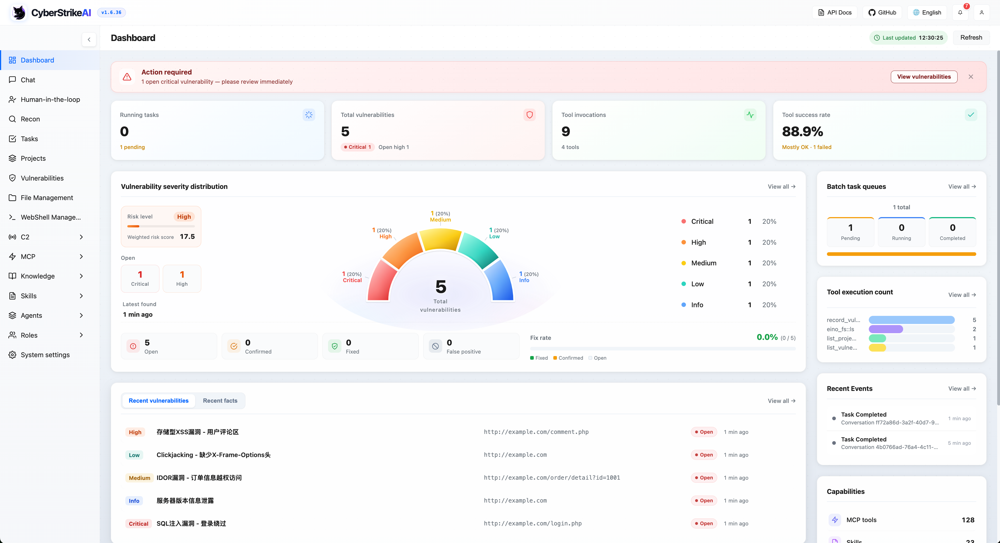
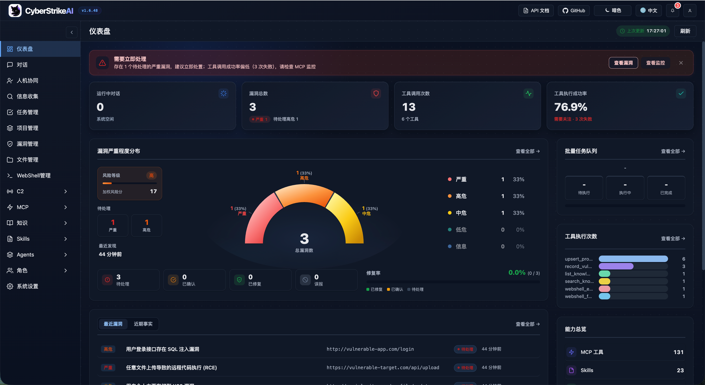
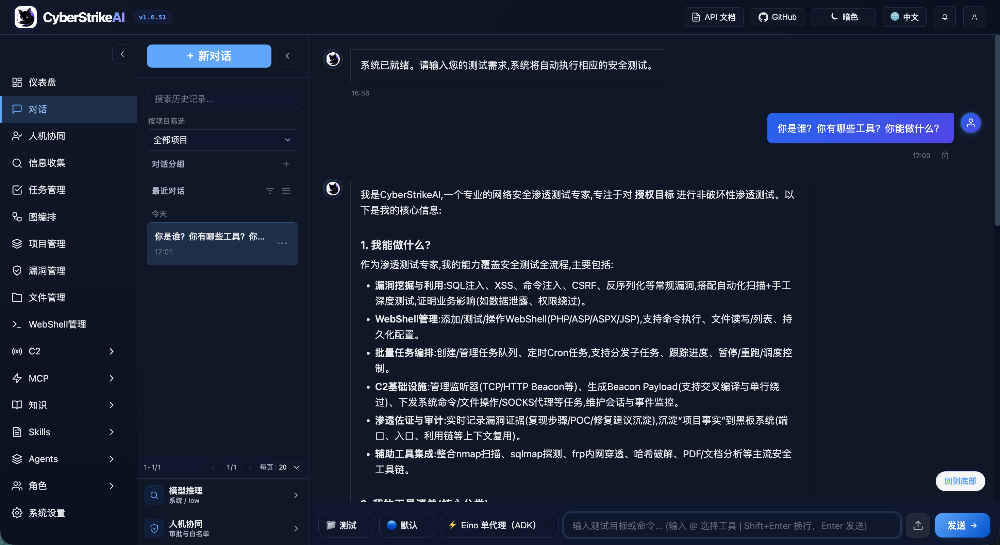
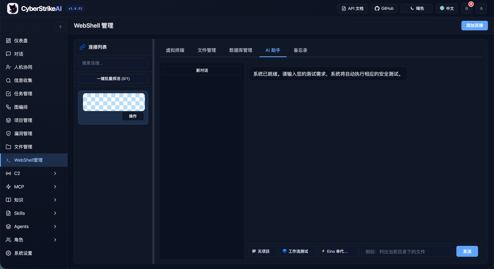
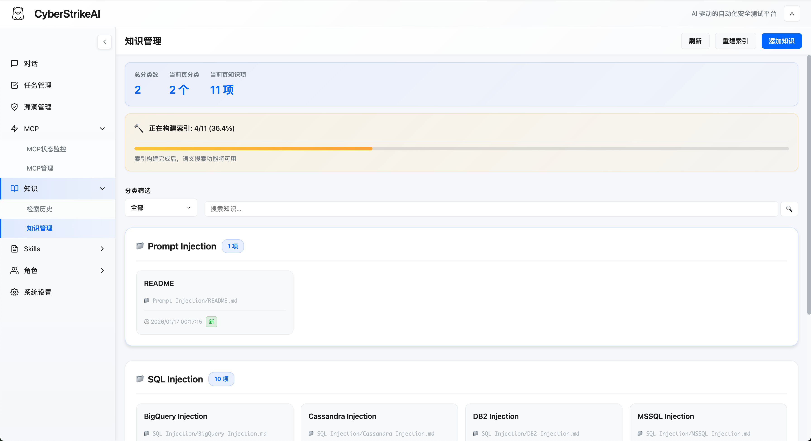
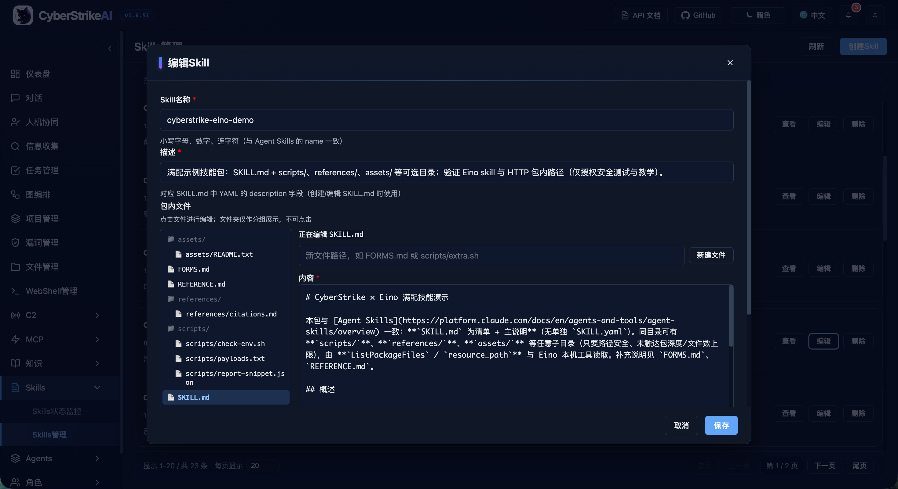
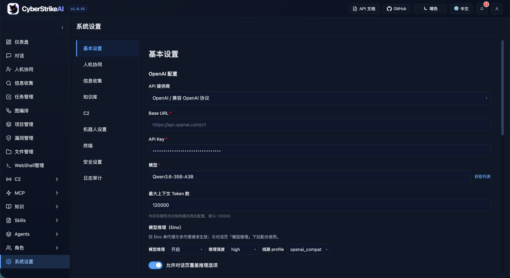
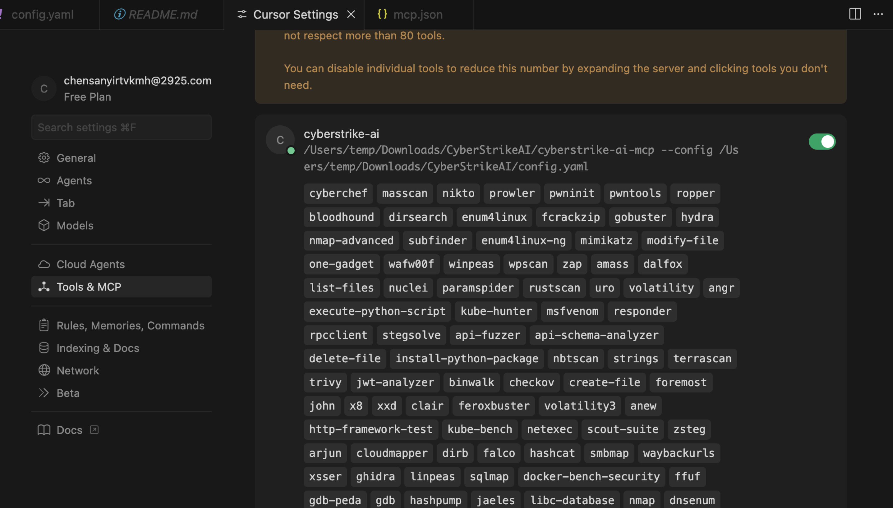
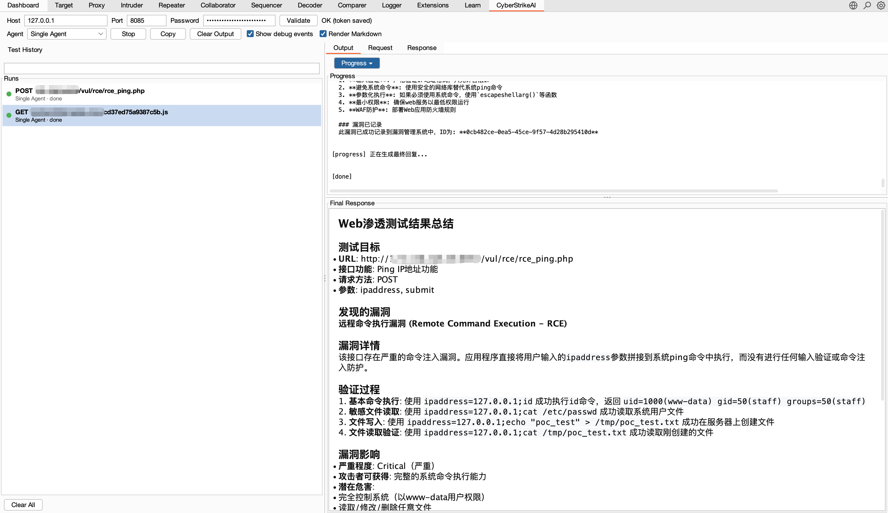

<div align="center">
  
</div>

# CyberStrikeAI


[한국어](README_KO.md) | [中文](README_CN.md) | [English](README.md)

**실행(Action)이 중심이 되는 AI 네이티브 사이버보안 시스템 — 의도를 통제된 실행으로, 증거를 운영 메모리로 전환하고, 모든 운영이 다음 운영을 개선합니다.**

CyberStrikeAI는 계획, 실행, 사람 감독(human oversight), 증거, 리플레이(replay)를 하나의 감사 가능한(auditable) 워크스페이스로 연결합니다. Go로 구축되었으며, Eino 기반 에이전트, MCP 네이티브 툴, RAG 지식, 시각적 워크플로우, 그리고 인가된 보안 운영을 위한 공격 체인(attack-chain) 모델링 및 분석을 결합합니다.

**시작하기:** [퀵 스타트](#퀵-스타트-one-command-배포) · [문서](docs/en-US/README.md) · [보안 강화](docs/en-US/security-hardening.md)

> [!IMPORTANT]
> CyberStrikeAI는 본인이 소유하거나 명시적으로 테스트 권한을 받은 시스템에서만 사용하십시오. 공유 환경이나 프로덕션 환경에서는 고위험(high-risk) 툴, WebShell, C2 기능을 활성화하기 전에 [보안 모델](docs/en-US/security-model.md)과 [강화 가이드](docs/en-US/security-hardening.md)를 검토하십시오.

## 인터페이스 & 연동 미리보기

<div align="center">

### 시스템 대시보드 개요

<table>
<tr>
<td width="50%" align="center">
<strong>라이트 모드</strong><br/>

</td>
<td width="50%" align="center">
<strong>다크 모드</strong><br/>

</td>
</tr>
</table>

*대시보드는 시스템 런타임 상태, 보안 취약점, 툴 사용량, 지식 베이스에 대한 종합적인 개요를 제공하여, 사용자가 플랫폼의 핵심 기능과 현재 상태를 빠르게 파악할 수 있도록 돕습니다.*

<details>
<summary><strong>더 많은 인터페이스 스크린샷</strong></summary>

### 핵심 기능 개요

<table>
<tr>
<td width="33.33%" align="center">
<strong>Web 콘솔</strong><br/>

</td>
<td width="33.33%" align="center">
<strong>작업(Task) 관리</strong><br/>

</td>
<td width="33.33%" align="center">
<strong>취약점 관리</strong><br/>

</td>
</tr>
<tr>
<td width="33.33%" align="center">
<strong>WebShell 관리</strong><br/>

</td>
<td width="33.33%" align="center">
<strong>MCP 관리</strong><br/>

</td>
<td width="33.33%" align="center">
<strong>지식 베이스</strong><br/>

</td>
</tr>
<tr>
<td width="33.33%" align="center">
<strong>스킬(Skills) 관리</strong><br/>

</td>
<td width="33.33%" align="center">
<strong>에이전트 관리</strong><br/>

</td>
<td width="33.33%" align="center">
<strong>역할(Role) 관리</strong><br/>

</td>
</tr>
<tr>
<td width="33.33%" align="center">
<strong>시스템 설정</strong><br/>

</td>
<td width="33.33%" align="center">
<strong>MCP stdio 모드</strong><br/>

</td>
<td width="33.33%" align="center">
<strong>Burp Suite 플러그인</strong><br/>

</td>
</tr>
</table>

</details>

</div>

## 하이라이트

### 에이전트 및 오케스트레이션

- 🤖 **에이전틱 실행(Agentic execution)** 은 자연어 의도를 통제되고 감사 가능한 보안 작업으로 변환합니다.
- 🧩 **Eino 오케스트레이션** 은 단일 에이전트 실행과 함께 Deep, Plan-Execute, Supervisor 멀티 에이전트 모드를 지원합니다.
- 🔀 **그래프 워크플로우** 는 에이전트, 툴, 조건, 승인, 출력을 조합하여 재사용 가능한 플로우를 만듭니다.
- 🎭 **역할 기반 테스트** 는 일반적인 보안 시나리오에 대해 집중된 프롬프트와 툴 정책을 제공합니다.

### 툴 및 지식

- 🧰 **보안 툴** 은 100개 이상의 큐레이트된 YAML 레시피를 포함하며, 확장 커스텀 및 역할 범위 접근 제어와 role-scoped access를 지원합니다.
- 🔌 **MCP 연동** 은 HTTP, stdio, SSE, 외부 페더레이션(federation) 및 동적 툴 탐색을 지원합니다.
- ⏱️ **탄력적인 툴 실행** 은 차단되는 MCP/툴 호출을 한정된(agent-side) waits와 함께 워커에서 실행하며, 재개 가능한 `execution_id` 폴링, 취소(cancel), 서버별 서킷 브레이커(circuit breaker), 동시성(concurrency) 제한, 그리고 통합된 출력 상한(output caps)을 지원합니다.
- 🎯 **Agent Skills** 는 표준 Skill 레이아웃을 따르며, 점진적(progressive)·온디맨드 로딩을 지원합니다.
- 📚 **지식 베이스** 는 쿼리 재작성(query rewriting), 벡터 검색, 리랭킹(reranking), 결과 후처리를 결합합니다.
- 🖼️ **비전 분석** 은 스크린샷, 캡차(captcha), UI에 별도의 비전 모델을 사용하며, 텍스트 요약만 보존합니다.

### 거버넌스 및 감사

- 🧑‍⚖️ **사람 감독(Human in the loop)** 은 승인 모드, 툴 허용 목록(allowlist), 감사 에이전트 검토, 추적 가능한 의사결정을 제공합니다.
- 🛡️ **호출 차단(Call blocking)** 은 Security 하에 구성 가능한 regex 검사를 MCP 실행 전에 수행하며, 리마인더(reminder) 템플릿과 dry run을 제공하고, 정부 도메인(government-domain) 보호를 기본 활성화합니다. 자세한 내용은 [Tool call blocking](docs/en-US/tool-call-guard.md)을 참조하십시오.
- 🔐 **플랫폼 RBAC** 은 다중 사용자, 시스템 및 커스텀 역할, 범위 지정된 권한(permission), 소유권(ownership), 명시적 할당을 지원합니다.
- 🔒 **보안 및 감사** 는 인증된 접근, 감사 로그, SQLite 지속성(persistence), 운영 증거 보존을 제공합니다.
- 📄 **결과 거버넌스(Result governance)** 는 에이전트가 본 것과 동일한 상한이 적용된(capped) 툴 결과를 저장하고, 과도하게 큰 이력 히스토리로 인한 재개(resume) 경로를 보호하며, 큰 상세 뷰(detail view)에 대한 UI 안전 장치를 제공합니다. 자세한 내용은 [Tool Execution Governance](docs/en-US/tool-execution-governance.md)를 참조하십시오.

### 보안 운영

- 📁 **대화 관리** 는 고정(pin), 이름 변경, 일괄 정리를 제공합니다.
- 📂 **프로젝트 및 공격 체인** 은 세션 간 사실(fact), 위험도 점수, 그래프 뷰, 단계별 리플레이를 연결합니다.
- 🗂️ **자산 관리** 는 도메인, IP 주소, 포트, 서비스를 정규화과 중복 제거하며, XLSX/CSV 가져오기/내보내기, 고급 필터 및 저장된 뷰(saved view), 소유권 및 비즈니스 메타데이터, 페이지 간 일괄 유지 관리, 중복 병합을 지원합니다. 또한 스캔 커버리지, 연결된 취약점, 위험 상태를 추적합니다. 자세한 내용은 [자산 관리 가이드](docs/en-US/asset-management.md)를 참조하십시오.
- 🛡️ **취약점 관리** 는 심각도 분류, 생명주기(lifecycle) 추적, 필터링, 통계를 제공합니다.
- 📋 **배치 작업** 은 대기열 실행, 편집, 상태 추적, 결과 보존을 제공합니다.
- 📱 **챗봇(Chatbot)** 은 Personal WeChat, WeCom, DingTalk, Lark, Telegram, Slack, Discord, QQ Bot을 연결합니다.

### 인가된 보안 운영

- 🐚 **WebShell 관리** 는 연결 관리, 가상 터미널, 파일 작업, AI 보조 워크플로우를 제공합니다.
- 📡 **내장 C2** 는 리스너(listener), 암호화된 비콘(beacon), 세션, 작업 대기열(task queue), 페이로드 헬퍼(payload helper), 라이브 이벤트를 제공합니다.

> WebShell, C2 및 기타 고위험(high-risk) 기능은 본인이 소유하거나 명시적으로 테스트 권한을 받은 시스템에서만 사용하십시오. 자세한 내용은 [보안 모델](docs/en-US/security-model.md)과 [강화 가이드](docs/en-US/security-hardening.md)를 참조하십시오.

## 플러그인

CyberStrikeAI는 `plugins/` 하에 선택적 연동 기능을 포함합니다.

- **Burp Suite 확장**: `plugins/burp-suite/cyberstrikeai-burp-extension/`  
  빌드 산출물: `plugins/burp-suite/cyberstrikeai-burp-extension/dist/cyberstrikeai-burp-extension.jar`  
  문서: `plugins/burp-suite/cyberstrikeai-burp-extension/README.md`
- **브라우저 확장 (Chrome / Edge)**: `plugins/browser-extension/cyberstrikeai-browser-extension/`  
  DevTools에서 Network 트래픽을 캡처하여 AI 보조 보안 테스트를 위해 CyberStrikeAI로 전송합니다—Burp 플러그인과 정렬됩니다.  
  설치: `chrome://extensions/` → 압축 해제 폴더 로드 → F12 → **CyberStrikeAI** 탭  
  패키지 산출물: `plugins/browser-extension/cyberstrikeai-browser-extension/dist/cyberstrikeai-browser-extension.zip`  
  문서: `plugins/browser-extension/cyberstrikeai-browser-extension/README.md` / `README.zh-CN.md`

## 툴 개요

CyberStrikeAI는 킬 체인(kill chain) 전체를 커버하는 100개 이상의 큐레이트된 툴을 포함합니다:

<details>
<summary><strong>전체 툴 카테고리 보기</strong></summary>

- **네트워크 스캐너** – nmap, masscan, rustscan, arp-scan, nbtscan
- **웹 & 앱 스캐너** – sqlmap, nikto, dirb, gobuster, feroxbuster, ffuf, httpx
- **취약점 스캐너** – nuclei, wpscan, wafw00f, dalfox, xsser
- **서브도메인 열거** – subfinder, amass, findomain, dnsenum, fierce
- **네트워크 공간 검색 엔진** – fofa_search, zoomeye_search, quake_search, shodan_search
- **API 보안** – graphql-scanner, arjun, api-fuzzer, api-schema-analyzer
- **컨테이너 보안** – trivy, clair, docker-bench-security, kube-bench, kube-hunter
- **클라우드 보안** – prowler, scout-suite, cloudmapper, pacu, terrascan, checkov
- **바이너리 분석** – gdb, radare2, ghidra, objdump, strings, binwalk
- **익스플로잇(Exploitation)** – metasploit, msfvenom, pwntools, ropper, ropgadget
- **비밀번호 크래킹** – hashcat, john, hashpump
- **포렌식(Forensics)** – volatility, volatility3, foremost, steghide, exiftool
- **post-exploitation** – linpeas, winpeas, mimikatz, bloodhound, impacket, responder
- **CTF 유틸리티** – stegsolve, zsteg, hash-identifier, fcrackzip, pdfcrack, cyberchef
- **시스템 헬퍼** – exec, create-file, delete-file, list-files, modify-file

</details>

툴 정의, 커스터마이징, 사용 노트는 [tools/README_EN.md](tools/README_EN.md)를 참조하십시오.

## 기본 사용법

### 퀵 스타트 (One-Command 배포)

**사전 요구 사항:**
- Go 1.25+ ([설치](https://go.dev/dl/); `go.mod`에서 요구)
- Python 3.10+ ([설치](https://www.python.org/downloads/))

**One-Command 배포:**
```bash
git clone https://github.com/Ed1s0nZ/CyberStrikeAI.git
cd CyberStrikeAI
chmod +x run.sh && ./run.sh
```

`run.sh` 스크립트는 자동으로 다음을 수행합니다:
- ✅ Go & Python 환경 검사 및 검증
- ✅ Python 가상 환경(venv) 생성
- ✅ Python 의존성 설치
- ✅ Go 의존성 다운로드
- ✅ 프로젝트 빌드
- ✅ 서버 시작

**시작 확인:**

1. 터미널에 `● ONLINE`이 표시된 뒤 실제 Web UI URL이 출력되는지 확인합니다.
2. 해당 URL을 엽니다. 기본 HTTPS 모드는 로컬 자체 서명 인증서(self-signed)를 사용하므로 브라우저 경고를 한 번 승인합니다.
3. 신규 설치의 경우, `ADMIN SETUP REQUIRED` 아래에 표시되는 일회성 `admin` 비밀번호를 저장하고, 로그인한 뒤 즉시 변경하십시오.

**네트워크 기본값:** `run.sh`는 **`--https`**와 저장소 **`config.yaml`**로 서버를 시작합니다(로컬 자체 서명 TLS; 동시 스트림이 많은 경우에 유리). 순수 HTTP를 사용하려면 **`./run.sh --http`**를 사용하십시오. 프로덕션에서는 **`config.yaml`**의 **`server.tls_cert_path`** / **`server.tls_key_path`**를 설정하십시오(해당 파일의 주석 참조). 수동 실행 시에는 **`--https`** 또는 **`CYBERSTRIKE_HTTPS=1`**을 추가하십시오. **`-config`** 경로가 잘못되면 바이너리가 stderr에 간단한 사용법 힌트를 출력합니다.

**첫 설정(First-Time Configuration):**
1. **AI 채널 구성** (사용 전 필수)
   - 실행 후 **`https://127.0.0.1:8080/`** (또는 **`https://localhost:8080/`**; **8080**은 `config.yaml`의 `server.port`로 대체)을 열고 자체 서명 인증서 경고를 한 번 승인합니다. `./run.sh --http`를 사용했다면 **`http://`**를 사용하십시오.
   - `시스템 설정` → `기본 설정` → `AI 채널 구성`으로 이동하여 채널을 추가/편집하고 provider, Base URL, API key, model, 토큰 한도를 입력한 뒤 **변경사항 저장**을 클릭합니다. 좌측 채널 목록에서는 기본 설정, 복사, 삭제, 일괄 프로브(probe)를 지원합니다.
     ```yaml
     ai:
       default_channel: openai-main
       channels:
         openai-main:
           name: OpenAI Main
           provider: openai_compatible
           api_key: "${OPENAI_API_KEY}"
           base_url: "https://api.openai.com/v1"  # 또는 https://api.deepseek.com/v1
           model: "gpt-4o"  # 또는 deepseek-chat, qwen3-max 등
           max_total_tokens: 120000
           max_completion_tokens: 16384
     ```
   - 또는 실행 전에 `config.yaml`을 직접 편집하십시오. `ai.default_channel`은 새 대화와 명시적으로 채널을 선택하지 않은 작업에 사용되며, 채팅 페이지에서는 세션별로 저장된 채널을 선택할 수 있습니다.
2. **로그인** - 최초 시작 시 콘솔에 자동 생성된 초기 `admin` 비밀번호가 출력됩니다. **플랫폼 권한 → 사용자 관리**에서 계정을 생성하십시오.
3. **보안 툴 설치 (선택)** - 필요에 따라 `tools/`에서 툴을 설치하십시오. 누락된 툴은 런타임에 건너뛰거나 대체합니다. 일반적인 예시:

   **macOS (Homebrew):**
   ```bash
   brew install nmap masscan sqlmap nikto gobuster ffuf hydra hashcat nuclei subfinder
   ```

   **Linux (Kali / Debian / Ubuntu):**
   ```bash
   sudo apt update
   sudo apt install -y nmap masscan sqlmap nikto gobuster hydra hashcat john binwalk
   # 일부 배포판에서는 ffuf/nuclei/subfinder를 go install 또는 upstream 문서로 설치해야 합니다
   ```

   전체 목록은 `tools/` 디렉터리를 참조하십시오. 각 툴의 설치 세부 사항은 공식 문서를 확인하십시오.

**대체 실행 방법:**
```bash
# 직접 Go 실행(환경은 직접 설정); run.sh 기본값과 맞추려면 --https 추가
go run ./cmd/server --https

# 수동 빌드
go build -o cyberstrike-ai ./cmd/server
./cyberstrike-ai --https
```

서버 로그에 `client sent an HTTP request to an HTTPS server`가 표시되면, 클라이언트가 TLS 전용 포트에서 여전히 **`http://`**를 사용 중이라는 뜻입니다—URL을 **`https://`**로 바꾸십시오.

**참고:** Python 가상 환경(`venv/`)은 `run.sh`가 자동으로 생성·관리합니다. Python이 필요한 툴(예: `api-fuzzer`, `http-framework-test` 등)는 이 환경을 자동으로 사용합니다.

### Windows 실행 참고 사항 (WSL 포함)

`run.sh`는 bash 스크립트이므로 Windows에서는 **WSL(Kali 등)** 사용을 권장합니다. WSL 외부(순수 PowerShell)에서 실행하려면 다음을 주의하십시오:

- **CGO 및 C 컴파일러 필요**: SQLite 드라이버(`mattn/go-sqlite3`)는 CGO를 요구하므로, Windows에서는 gcc(MinGW-w64 / MSYS2 등)가 설치되어 있어야 하고 `go env -w CGO_ENABLED=1`로 설정해야 빌드가 성공합니다.
- **bash 부재**: WSL/Git Bash 없이는 `run.sh`를 그대로 실행할 수 없으므로 `go run ./cmd/server --https`를 대신 사용하십시오.
- **Python 별칭**: Windows에서는 `python` 대신 `py` 런처로 설치되는 경우가 많으므로 `python` 명령이 없다면 `py`를 사용하거나 PATH를 설정하십시오.
- **소스 무결성**: ZIP 압축 해제본이 아닌 `git clone`으로 저장소를 받으십시오. 일부 파일이 누락된 스냅샷(예: `internal/c2`의 oneliner 정의 누락)은 `undefined: c2.OnelinerKind` 등 컴파일 오류를 발생시킵니다.

**Kali WSL 권장 절차:**
```bash
sudo apt update
sudo apt install -y git curl build-essential python3 python3-venv python3-pip
# go.mod가 Go 1.25+를 요구하므로 필요 시 공식 설치:
#   wget https://go.dev/dl/go1.25.0.linux-amd64.tar.gz
#   sudo rm -rf /usr/local/go && sudo tar -C /usr/local -xzf go1.25.0.linux-amd64.tar.gz
#   echo 'export PATH=$PATH:/usr/local/go/bin' >> ~/.bashrc && source ~/.bashrc
cd ~
git clone https://github.com/Ed1s0nZ/CyberStrikeAI.git
cd CyberStrikeAI
chmod +x run.sh && ./run.sh
```
> `/mnt/c` 경로는 속도와 실행 권한 문제가 있어 Linux 홈 디렉터리에서 clone·실행하는 것을 권장합니다.

### 업그레이드 및 호환성

**플랫폼 자체의 원클릭 업데이트를 권장**합니다(콘솔 시스템 설정 → 원클릭 업데이트, 또는
`./cyberstrike-ai -update` / `-check-update` / `-update-rollback`): 이 기능은 **업데이트 소스 저장소**의
기본 브랜치의 최신 커밋을 당겨오며(기본은 공식 저장소이며, 설정 하나로 자신의 fork나 미러로 지정 가능),
fast-forward하고, 바이너리를 재빌드하여 원자적으로 교체하며, `roles/skills/tools/agents/data/config.yaml`을
건드리지 않고 보존합니다(결과가 보존한 모든 파일을 명시하며, 헤더 배지(badge)가 이를 반영하도록 `config.yaml`의
`version` 필드만 새 코드로 동기화합니다). 로컬 소스가 수정되었거나 로컬 이력이 갈라진(diverged) 경우에는
덮어쓰지 않고 거부합니다. 자세한 내용은 [배포 가이드](docs/en-US/deployment.md)를 참조하십시오.

`upgrade.sh`도 여전히 동작합니다: 이 디렉터리가 git 작업 트리일 경우에는 위 명령에 대한 얇은 셸(shell) 래퍼이며,
git이 아닌(tarball) 설치에서만 기존의 "GitHub Release를 다운로드하여 rsync로 동기화" 경로로 폴백(fallback)합니다.
tarball 경로에서 소스 저장소는 `--repo owner/name` 또는 `GITHUB_REPO`에서 오며, 둘 다 주어지지 않은 경우에만
내장 기본값이 적용됩니다(저장소 이름을 명시하는 경고와 함께).

업데이트 소스는 `config.yaml`의 `update` 섹션에 저장소 주소로 지정하거나 콘솔 페이지에서 바로 설정하는
설정 하나입니다—공식 저장소, 자신의 fork, 또는 다른 사람의 fork. Release 아카이브에서 압축 해제한(git 아님)
설치는 동일한 페이지에서 미리보기 및 연결한 후, 이후로는 원클릭으로 업데이트할 수 있습니다.

**CyberStrikeAI 업그레이드 스크립트:**
1. (최초 1회) 스크립트 활성화: `chmod +x upgrade.sh`
2. 업그레이드: `./upgrade.sh` (선택 플래그: `--check`, `--tag vX.Y.Z`, `--repo owner/name`, `--no-venv`, `--yes`). 로컬 `tools/`, `roles/`, `skills/`, `agents/`는 항상 보존됩니다.
3. 스크립트는 `config.yaml`과 `data/`를 백업하고, 코드를 업그레이드하며, `config.yaml`의 `version`을 갱신한 뒤 서버를 재시작합니다.

권장 원라이너(one-liner):
`chmod +x upgrade.sh && ./upgrade.sh --yes`

문제 발생 시: git 작업 트리 내에서는 `./cyberstrike-ai -update-rollback`을 실행하면 됩니다(마지막 업데이트 직전의 커밋과 바이너리로 복원). tarball 설치의 경우 `.upgrade-backup/`에서 복원하거나(또는 `data/`와 `config.yaml`을 수동으로 되돌린 뒤) `./run.sh`를 다시 실행하십시오.

요구 사항 / 팁 (tarball 경로 전용):
* Release 패키지를 다운로드하려면 `curl` 또는 `wget`이 필요합니다.
* 안전한 코드 동기화를 위해 `rsync`를 권장/필요로 합니다.
* GitHub API rate-limit에 걸리면 실행 전에 `export GITHUB_TOKEN="..."`를 설정하십시오.

⚠️ **업그레이드 전:** 대상 릴리스 노트의 구성, 데이터베이스, API 변경 사항을 검토하십시오. 패치 업그레이드라도 백업이 필수이며, 버전 번호 자체만으로는 호환성을 보장하지 않습니다.


## 구성

[`config.example.yaml`](config.example.yaml)을 권위 있는 구성 템플릿으로 사용하고, 환경에 필요한 값만 복사하십시오. 최소한 서버와 AI 채널 하나를 구성해야 합니다:

```yaml
server:
  host: "127.0.0.1"
  port: 8080
ai:
  default_channel: openai-main
  channels:
    openai-main:
      provider: openai_compatible
      api_key: "${OPENAI_API_KEY}"
      base_url: "https://api.openai.com/v1"
      model: "your-model"
```

`openai`는 하위 호환을 위한 런타임 필드입니다. 새 모델 설정은 `ai.channels`에서 관리하십시오. 실제 자격 증명을 커밋하지 마십시오. localhost 밖으로 서비스를 노출하기 전에 [구성 레퍼런스](docs/en-US/configuration.md), [권장 프로필](docs/en-US/configuration-profiles.md), [보안 강화 가이드](docs/en-US/security-hardening.md)를 검토하십시오.

## 관련 문서

- **신규 사용자:** [배포](docs/en-US/deployment.md) → [구성](docs/en-US/configuration.md) → [문제 해결](docs/en-US/troubleshooting.md)
- **운영자:** [구성 프로필](docs/en-US/configuration-profiles.md) → [보안 강화](docs/en-US/security-hardening.md) → [런북(Runbooks)](docs/en-US/runbooks.md)
- **연동 개발자:** [API 레퍼런스](docs/en-US/api-reference.md) → [API 레시피](docs/en-US/api-recipes.md) → [MCP 페더레이션](docs/en-US/mcp-federation.md)
- **기여자:** [개발자 가이드](docs/en-US/developer-guide.md) → [테스트](docs/en-US/testing.md) → [기여 가이드](docs/en-US/contributing-guide.md)
- **전체 주제:** [영문 문서](docs/en-US/README.md) · [이중 언어 문서 인덱스](docs/README.md)

## 프로젝트 레이아웃

```
CyberStrikeAI/
├── cmd/                 # 서버, MCP stdio 진입점, 툴링
├── internal/            # 에이전트, MCP 코어, 핸들러, C2 (`internal/c2`), 보안 실행기(executor)
├── web/                 # 정적 SPA + 템플릿
├── tools/               # YAML 툴 레시피 (100+ 예시 제공)
├── roles/               # 역할 구성 (12+ 사전 정의된 보안 테스트 역할)
├── skills/              # Agent Skills 디렉터리 (SKILL.md + 선택 파일; demo: cyberstrike-eino-demo)
├── agents/              # 멀티 에이전트 Markdown (orchestrator.md + 서브 에이전트 *.md)
├── docs/                # 주제별 문서 (배포, 구성, 보안, API, 지식 베이스, C2, WebShell 등)
├── images/              # 문서 스크린샷 및 다이어그램
├── config.yaml          # 런타임 구성
├── run.sh               # 편의 실행 스크립트
└── README*.md
```

## 기본 사용 예시

```
Scan open ports on 192.168.1.1
Perform a comprehensive port scan on 192.168.1.1 focusing on 80,443,22
Check if https://example.com/page?id=1 is vulnerable to SQL injection
Scan https://example.com for hidden directories and outdated software
Enumerate subdomains for example.com, then run nuclei against the results
```

## 고급 플레이북(Playbooks)

```
Load the recon-engagement template, run amass/subfinder, then brute-force dirs on every live host.
Use external Burp-based MCP server for authenticated traffic replay, then pass findings back for graphing.
Compress the 5 MB nuclei report, summarize critical CVEs, and attach the artifact to the conversation.
Build an attack chain for the latest engagement and export the node list with severity >= high.
```

## 404Starlink 


CyberStrikeAI는 [404Starlink](https://github.com/knownsec/404StarLink)에 참여했습니다.

## TCH 상위 랭킹 침투 테스트 프로젝트 (Top-Ranked Intelligent Pentest Project)  
<div align="left">
  <a href="https://zc.tencent.com/competition/competitionHackathon?code=cha004" target="_blank">
    
  </a>
</div>


---

## 커뮤니티 및 지원

- [Discord](https://discord.gg/8PjVCMu8Zw)에서 커뮤니티에 참여하십시오.

<details>
<summary><strong>WeCom 그룹</strong></summary>


</details>

## 라이선스

CyberStrikeAI는 Apache License 2.0에 따라 라이선스됩니다.  
자세한 내용은 [LICENSE](LICENSE) 파일을 참조하십시오.

---

## ⚠️ 면책 조항 (Disclaimer)

**이 도구는 교육 및 인가된 테스트 목적 전용입니다!**

CyberStrikeAI는 보안 연구자, 침투 테스트 전문가, IT 전문가가 **명시적인 권한을 받아** 보안 평가 및 취약점 연구를 할 수 있도록 돕는 전문 보안 테스트 플랫폼입니다.

**이 도구를 사용함으로써 귀하는 다음에 동의합니다:**
- 명확한 서면 권한을 받은 시스템에서만 이 도구를 사용
- 적용되는 모든 법률, 규정, 윤리 기준을 준수
- 권한 없는 사용 또는 오용에 대한 모든 책임을 짐
- 불법적 또는 악의적인 목적으로 이 도구를 사용하지 않음

**개발자는 어떠한 오용에 대해서도 책임을 지지 않습니다!** 사용이 현지 법률 및 규정을 준수하는지 확인하고, 대상 시스템 소유자로부터 명시적 권한을 취득했는지 확인하십시오.

취약점 신고 및 배포 강화 가이드는 [SECURITY.md](SECURITY.md)를 참조하십시오.

---

도움이 필요하거나 기여를 원하시나요? issue 또는 PR을 열어 주십시오—커뮤니티 툴링 추가를 환영합니다!
